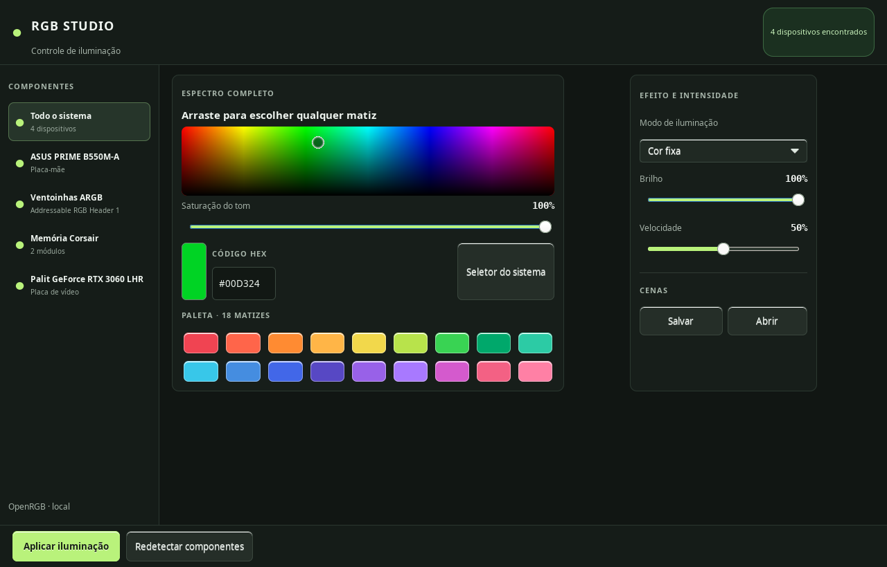
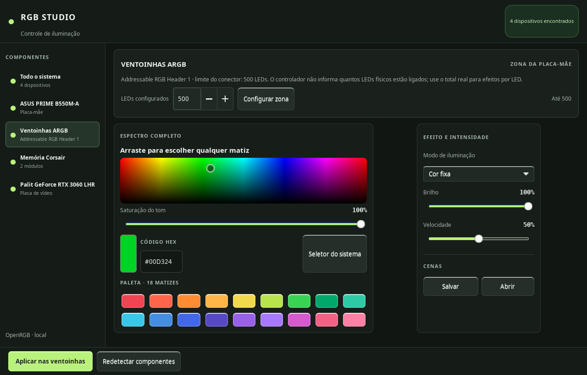

# RGB Studio for COSMIC

[Versão em português](README.md)

RGB lighting controls for the COSMIC desktop, built with GTK 3 and powered by [OpenRGB](https://openrgb.org/).

> Community project in development. Device and effect support depends on what the installed OpenRGB version exposes.

> Current version: [**v0.1.2**](https://github.com/FernandoBolzan/rgb-studio-cosmic/releases/tag/v0.1.2) · [changelog](CHANGELOG.md)

## Features

- Detects devices supported by OpenRGB.
- Pick hue and brightness by dragging across the spectrum; adjust saturation, enter a HEX value, or choose from 18 named swatches.
- Controls brightness, speed, and effects exposed by each device.
- Saves and restores RGB scenes.
- Targets devices and addressable ARGB zones reported by OpenRGB.
- Sends the right number of colors for Corsair Vengeance RGB memory modes.
- Adds software Blink, Breathe, and Rainbow effects for GPUs that only expose Direct/Off in OpenRGB.

Choosing a color updates the preview. Hardware changes are sent only after clicking **Apply lighting**. The LED count for an ARGB zone must be entered by the user; the application cannot count the physical LEDs in a chain.

Available effects depend on each device. When **All devices** or a group is selected, the list shows only modes shared by every component in that target. Select an individual component to access its specific effects. RGB Studio sends OpenRGB the exact mode name reported by the device; if a saved mode is no longer available, restoration reports the issue instead of silently switching to a different effect. Brightness and speed also depend on support from the effect and device.

For Corsair Vengeance RGB memory, two-color modes receive a darker secondary shade derived from the selected color. For GPUs that only expose **Direct** and **Off**, RGB Studio adds software **Blink**, **Breathe**, and **Rainbow** effects over a persistent SDK connection; keep RGB Studio running while one of these effects is active. RGB Studio keeps a profile per component and restores every configured profile at startup and when the computer resumes from sleep or hibernation.

## Screenshots

The ARGB screenshot shows the setting from the machine used to capture it. Enter the physical LED count for your own setup; the displayed value is not detected automatically. The screenshots show the current Portuguese app interface.





## Requirements

- Linux with COSMIC or another desktop that displays Ayatana/AppIndicator status icons.
- Python 3, PyGObject, GTK 3, and Ayatana AppIndicator 3.
- The OpenRGB CLI with support for your devices. OpenRGB is a separate dependency and is not bundled in this repository.

On Pop!_OS, Ubuntu, or Debian, install the UI dependencies with:

```bash
sudo apt install python3-gi gir1.2-gtk-3.0 gir1.2-ayatanaappindicator3-0.1
```

Install OpenRGB from its [official releases](https://openrgb.org/releases.html). Linux downloads include AppImages and packages for supported distributions. To use a custom installation, set `RGB_PANEL_OPENRGB` to the executable path. If unset, RGB Studio checks `~/.local/share/rgb-panel/openrgb/AppRun` first, then looks for `openrgb` on `PATH`.

Some OpenRGB Linux installations require udev rules to access hardware. See the [official OpenRGB udev instructions](https://openrgb.org/udev.html).

## Installation

```bash
git clone --branch v0.1.2 --depth 1 https://github.com/FernandoBolzan/rgb-studio-cosmic.git
cd rgb-studio-cosmic
install -Dm755 rgb_panel.py "$HOME/.local/share/rgb-panel/rgb_panel.py"
install -Dm644 rgb-panel.svg "$HOME/.local/share/rgb-panel/rgb-panel.svg"
install -Dm644 contrib/rgb-panel.service "$HOME/.config/systemd/user/rgb-panel.service"
systemctl --user daemon-reload
systemctl --user enable --now rgb-panel.service
```

The RGB icon appears in the COSMIC status area. Choose **RGB Studio → Open full studio…**. To run without enabling the service, launch the installed file with `python3`.

## Preferences and scenes

Preferences are stored in `~/.config/rgb-panel/settings.json`, and scenes in `~/.config/rgb-panel/presets/`. These files stay local and are not part of the repository. Once OpenRGB detects the devices, RGB Studio reapplies every saved component profile at startup and after sleep or hibernation. If a component appears late, the app retries device discovery. Each profile stores its target, color, effect, brightness, speed, and (for ARGB zones) LED count. Scenes also store the component and zone count.

Preference files from older versions store only the color and LED count. On the first restore, the app applies them to **All devices**, preferring a fixed-color mode when available, with 100% brightness and 50% speed; future applications also save the target and remaining settings.

## Development

```bash
python3 -m py_compile rgb_panel.py
python3 -m unittest discover -s tests -v
```

Contributions are welcome. Read [CONTRIBUTING.md](CONTRIBUTING.md) before opening a pull request.

## License

Distributed under the [MIT License](LICENSE).
