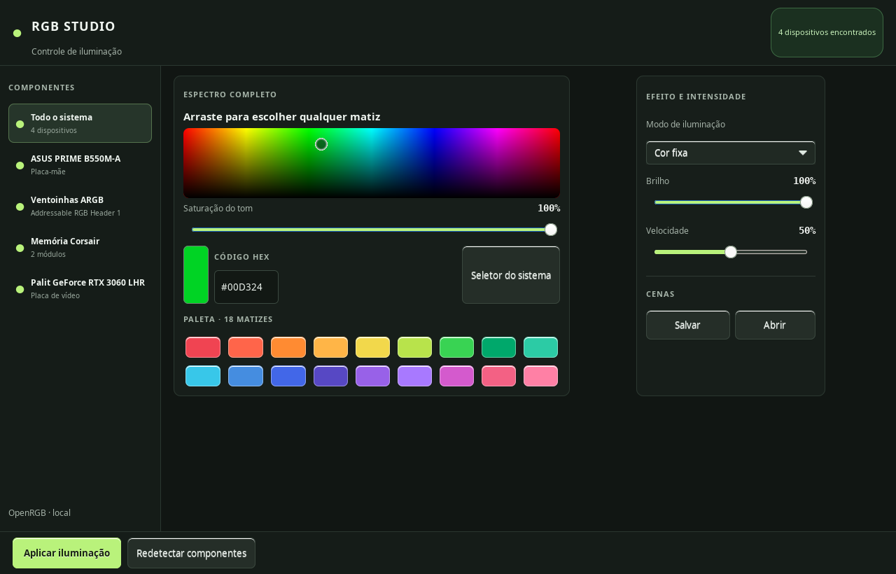
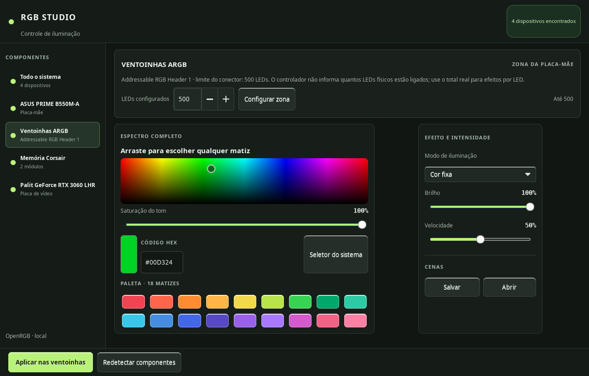

# RGB Studio para COSMIC

[English version](README.en.md)

Painel de iluminação RGB para a área de trabalho COSMIC, com interface GTK 3 e controle dos dispositivos por meio do [OpenRGB](https://openrgb.org/).

> Projeto comunitário em desenvolvimento. O suporte depende dos dispositivos e modos expostos pela versão do OpenRGB instalada.

## Recursos

- Detecta dispositivos reconhecidos pelo OpenRGB.
- Escolhe matiz e brilho arrastando no espectro; ajusta a saturação, informa o código HEX ou escolhe entre 18 tons.
- Controla brilho, velocidade e efeitos que o dispositivo disponibiliza.
- Salva e recupera cenas RGB.
- Permite selecionar um dispositivo ou uma zona ARGB da placa-mãe.

A seleção de cor atualiza a prévia. A iluminação só é enviada ao hardware quando você clica em **Aplicar iluminação**. A quantidade de LEDs de uma zona ARGB precisa ser informada pelo usuário; o aplicativo não consegue contar os LEDs físicos da cadeia.

## Capturas de tela

A captura da zona ARGB mostra a configuração usada na máquina que gerou a imagem. Informe a quantidade física de LEDs do seu próprio conjunto; o valor exibido não é uma detecção automática.





## Requisitos

- Linux com COSMIC ou outro ambiente que mostre indicadores Ayatana/AppIndicator.
- Python 3, PyGObject, GTK 3 e Ayatana AppIndicator 3.
- OpenRGB CLI compatível com os dispositivos. O OpenRGB é uma dependência separada e não é distribuído neste repositório.

No Pop!_OS, Ubuntu ou Debian, as dependências da interface podem ser instaladas com:

```bash
sudo apt install python3-gi gir1.2-gtk-3.0 gir1.2-ayatanaappindicator3-0.1
```

Instale o OpenRGB pelas [versões oficiais](https://openrgb.org/releases.html). No Linux, o projeto publica AppImages e pacotes para distribuições compatíveis. Para usar uma instalação personalizada, defina `RGB_PANEL_OPENRGB` com o caminho do executável. Sem essa variável, o RGB Studio procura primeiro `~/.local/share/rgb-panel/openrgb/AppRun` e depois `openrgb` no `PATH`.

Em algumas instalações do OpenRGB no Linux, são necessárias regras udev para permitir acesso ao hardware. Consulte as [instruções oficiais do OpenRGB para udev](https://openrgb.org/udev.html).

## Instalação

```bash
git clone https://github.com/FernandoBolzan/rgb-studio-cosmic.git
cd rgb-studio-cosmic
install -Dm755 rgb_panel.py "$HOME/.local/share/rgb-panel/rgb_panel.py"
install -Dm644 rgb-panel.svg "$HOME/.local/share/rgb-panel/rgb-panel.svg"
install -Dm644 contrib/rgb-panel.service "$HOME/.config/systemd/user/rgb-panel.service"
systemctl --user daemon-reload
systemctl --user enable --now rgb-panel.service
```

O ícone RGB aparece na área de indicadores do COSMIC. Abra **RGB Studio → Abrir estúdio completo…**. Para iniciar sem habilitar o serviço, execute o arquivo instalado com `python3`.

## Preferências e cenas

As preferências ficam em `~/.config/rgb-panel/settings.json`, e as cenas em `~/.config/rgb-panel/presets/`. Esses arquivos são locais e não fazem parte do repositório. Depois que o OpenRGB detecta os dispositivos, o RGB Studio reaplica a última iluminação configurada ao iniciar. A preferência guarda o alvo, a cor, o efeito, o brilho, a velocidade e, para zonas ARGB, a quantidade de LEDs.

Arquivos de preferências de versões antigas guardam apenas a cor e a quantidade de LEDs. Na primeira restauração, esses arquivos são aplicados a **Todo o sistema**, priorizando um modo de cor fixa quando disponível, com brilho em 100% e velocidade em 50%; depois, a aplicação salva também o alvo e os demais ajustes.

## Desenvolvimento

```bash
python3 -m py_compile rgb_panel.py
```

Contribuições são bem-vindas. Leia [CONTRIBUTING.md](CONTRIBUTING.md) antes de abrir uma solicitação.

## Licença

Distribuído sob a licença [MIT](LICENSE).
